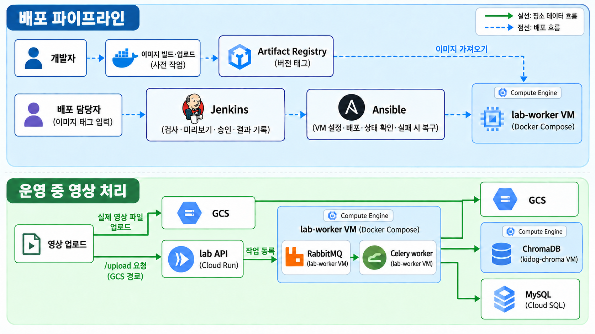
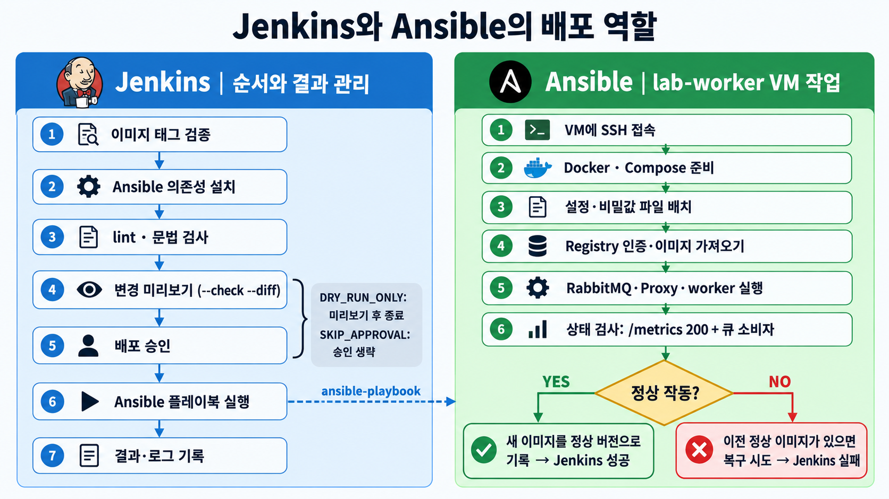

# 반려동물 영상 분석 worker 배포와 장애 실습

> 서비스 소개 → 전체 구조 → Ansible 배포 → Jenkins 파이프라인 → 장애 실습 → 다음 계획

---

## 1. 서비스 소개

반려동물 영상을 올리면 장면과 행동을 분석하고, 자연어로 검색할 수 있게 해 주는 서비스다.

- 영상 분석은 CLIP(이미지 임베딩), YOLO(객체 감지), 행동 분석(OpenAI)을 거치므로 **한 건에 2분 안팎**이 걸린다.
- 요청을 받는 즉시 처리하면 API가 오래 붙잡히므로, **접수와 분석을 큐로 분리**한 비동기 구조를 쓴다.
- 지금까지는 이 분석 worker가 로컬에서만 돌았다.

**이번 실습의 목표:** worker를 GCP로 옮기고, 그 **배포와 장애 대응을 Jenkins와 Ansible로 관리**해 본다.

---

## 2. 전체 구조와 역할 분담



그림의 파란 영역은 **배포 흐름**, 초록 영역은 **운영 중 영상 처리 흐름**이다. 점선은 배포에 필요한 이미지와 명령, 실선은 영상과 처리 결과의 이동을 나타낸다.

### 배포 흐름

1. 개발자가 worker Docker 이미지를 빌드해 **Artifact Registry**에 버전 태그와 함께 올린다.
2. 배포 담당자가 Jenkins에 태그를 입력한다. Jenkins는 입력값·코드·변경 사항을 검사하고 승인 후 Ansible playbook을 실행한다.
3. Ansible은 `lab-worker` VM을 설정하고, 지정한 이미지를 가져와 Docker Compose로 서비스를 실행한다. 상태 검증에 실패하면 직전 정상 이미지로 복구한다.

### 영상 처리 흐름

```text
영상 파일 → GCS 업로드
영상의 GCS 경로 → Cloud Run API (/upload, IAM 인증)
               → RabbitMQ (작업 주문서 보관)
               → Celery worker (lab-worker VM)
                   → GCS에서 영상 읽기 → 프레임 추출 → YOLO → CLIP
                   → GCS(추출한 프레임), ChromaDB(벡터), Cloud SQL(장면·행동 기록)에 저장
```

- 영상 파일 자체는 GCS에 올리고, API에는 **GCS 경로**를 전달한다. API는 `/upload`에서 경로를 검증하고 RabbitMQ에 작업을 등록하기만 한다.
- RabbitMQ와 worker는 `lab-worker` VM에서 Docker Compose로 돌며, worker는 Cloud SQL 프록시를 통해 DB에 접근한다. ChromaDB는 별도의 `kidog-chroma` VM에 있다.

### 도구별 역할

| 도구 | 하는 일 | 하지 않는 일 |
|---|---|---|
| gcloud | VM, 버킷, 서비스 계정, Cloud Run 같은 **클라우드 자원 생성** | VM 안쪽 설정 |
| **Ansible** | VM **안쪽**의 설치·설정·배포, 헬스 체크, 실패 시 복구 | 어떤 버전을 언제 배포할지 결정 |
| **Jenkins** | **어떤 버전**을 배포할지 선택, 검증 단계의 순서, 승인, 결과 기록 | 서버 안쪽 작업 직접 수행 |



> 한 줄 정리: **Ansible은 서버의 상태를 만들고, Jenkins는 그 절차를 통제한다.**

AWS로 바꿔 말하면 gcloud는 Terraform/콘솔(EC2 생성), Ansible은 EC2 안의 소프트웨어 설정, Jenkins는 CodePipeline 같은 배포 오케스트레이션에 해당한다.

---

## 3. Ansible 구성

### 3.1 디렉터리 구조

스터디 5주차의 Role 구조를 그대로 적용했다.

```text
ops/ansible/
├── ansible.cfg                        # vault 비밀번호 위치, pipelining 등
├── requirements.yml                   # community.docker collection
├── playbooks/site.yml                 # 진입점
├── inventory/
│   ├── lab.example.ini                # 대상 서버 예시 (실제 lab.ini는 Git 제외)
│   ├── jenkins.yml                    # Jenkins용 (VM 주소는 환경변수)
│   └── group_vars/all/
│       ├── vars.yml                   # 비밀이 아닌 설정
│       └── vault.yml                  # 암호화된 비밀
└── roles/
    ├── docker/tasks/main.yml          # Docker 설치
    └── worker/
        ├── defaults/main.yml          # 기본값
        ├── files/compose.yaml         # 그대로 복사
        ├── templates/*.j2             # 변수를 채워 렌더링
        └── tasks/{main,verify}.yml    # 배포, 검증, 복구
```

### 3.2 Playbook 진입점: `serial`

```yaml
- name: Configure and deploy the video worker
  hosts: worker
  become: true
  serial: 1                 # 한 번에 한 대씩 (롤링 배포)
  any_errors_fatal: true    # 하나라도 실패하면 즉시 중단
  roles:
    - { role: docker, tags: [docker] }
    - { role: worker, tags: [worker] }
```

지금은 VM이 한 대라 `serial`의 효과는 없지만, 서버가 늘어도 한 대씩 배포하고 실패 시 멈추는 구조를 미리 갖췄다 (스터디 3, 4번).

### 3.3 변수와 Vault

`vars.yml`에서는 비밀을 직접 쓰지 않고 **vault 변수를 가리키기만** 한다.

```yaml
worker_image: ".../api:{{ worker_image_tag }}"   # 이미지 주소 + 태그
worker_image_tag: "lab-901fae3-10051448"               # Jenkins가 -e로 덮어쓸 값
...
mysql_password: "{{ vault_mysql_password }}"
rabbitmq_password: "{{ vault_rabbitmq_password }}"
openai_api_key: "{{ vault_openai_api_key }}"
```

`vault.yml`은 `ansible-vault encrypt`로 암호화되어 Git에 올라가도 안전하다 (`$ANSIBLE_VAULT;1.2;AES256;lab`로 시작). 복호화 비밀번호가 든 `.vault_pass.lab`만 Git에서 제외한다. `ansible.cfg`의 `vault_identity_list = lab@.vault_pass.lab`은 Vault ID(환경별 이름표)를 쓴 것이다 (스터디 2번).

### 3.4 `files`와 `templates`

- `files/compose.yaml`: 있는 그대로 VM에 복사한다.
- `templates/*.j2`: 변수를 채워 만든 뒤 복사한다. 비밀이 들어가는 파일은 root만 읽게(`0600`) 하고 `no_log: true`로 로그에서 가린다.

```jinja
# compose.env.j2
WORKER_IMAGE={{ worker_image_to_run | default(worker_image) }}
```

평소에는 `worker_image`가 들어가고, 복구할 때는 `worker_image_to_run`을 task 변수로 덮어쓴다. 템플릿 하나로 "새 이미지"와 "복구 이미지" 두 경우를 처리하는 장치다.

### 3.5 핵심: 배포 → 검증 → 복구 (`block/rescue/always`)

```text
block   : .env 렌더링 → 레지스트리 로그인 → compose up
          → 헬스 체크 → 통과하면 .last_good_image에 기록
rescue  : 직전 정상 이미지로 .env 재렌더링 → 기동 → 복구 이미지 헬스 체크 → fail
always  : Docker 로그인 정보 삭제
```

구현 위치는 `roles/worker/tasks/main.yml`이다. 이 흐름에서 중요한 조건은 다음과 같다.

1. **헬스 체크는 두 겹이다.** 컨테이너가 바로 죽으면 `compose up --wait`가 잡고, 컨테이너는 살아 있지만 일을 못 하면 `verify.yml`이 잡는다.
   - `verify.yml`: worker 메트릭 엔드포인트가 200을 응답하는지, RabbitMQ에 소비자가 붙었는지를 재시도하며 확인
2. **`.last_good_image`는 검증을 통과한 이미지만 기록**하므로, 실패한 이미지가 복구 기준이 될 일이 없다.
3. **복구한 뒤에도 헬스 체크를 한다.** 복구 직후 worker가 준비되기까지 몇 번 더 기다려야 해서, 이 검증이 없으면 준비 안 된 worker를 정상으로 보고하게 된다.
4. **복구 후에도 `fail`로 끝낸다.** `rescue`가 끝나면 Play는 "복구됨"으로 계속 진행하므로, 일부러 실패시키지 않으면 파이프라인이 성공으로 오해한다. 결과는 `rescued=1`과 `failed=1`로 나타난다.
5. **`rescue` 안의 `block`은 try/except가 아니다.** 같은 `when` 조건을 task 세 개에 한 번에 걸기 위한 그룹이다.

### 3.6 멱등성

이미 맞춰진 서버에 같은 playbook을 다시 실행하면 `changed=0`이 나온다. Docker 설치 같은 task는 모듈(`apt`, `get_url`, `deb822_repository`, `service`)이 현재 상태를 확인하고 이미 같으면 `ok`로 끝낸다.

---

## 4. Jenkins 구성

### 4.1 구성 방식

Jenkins 컨트롤러 자체를 코드로 만들었다 (`ops/jenkins/`).

| 파일 | 역할 |
|---|---|
| `Dockerfile` | Jenkins에 `ansible-core 2.19.*`, `ansible-lint 25.*`를 고정 버전으로 설치 (스터디 5번의 "Agent 환경 통일") |
| `plugins.txt` | 필요한 플러그인 목록 |
| `casc/jenkins.yaml` | JCasC: 관리자 계정, **SSH 키와 Vault 비밀번호 Credential**, 파이프라인 job 정의 |
| `Jenkinsfile` | 파이프라인 본체 |

Credential은 화면에서 손으로 등록하지 않고 JCasC로 파일에서 읽어 등록한다.

```yaml
credentials:
  system:
    domainCredentials:
      - credentials:
          - basicSSHUserPrivateKey: { id: lab-worker-ssh, ... }
          - file:                   { id: lab-ansible-vault, fileName: vault_pass.lab, ... }
```

### 4.2 Jenkinsfile 단계

```text
파라미터 검증 → 의존성 설치 → Lint → Syntax check
   → Dry run(--check --diff) → 승인(input) → 배포 및 검증
```

핵심 부분:

```groovy
parameters {
  string(name: 'IMAGE_TAG', ...)
  booleanParam(name: 'DRY_RUN_ONLY', defaultValue: false, ...)
  booleanParam(name: 'SKIP_APPROVAL', defaultValue: false, ...)
}

stage('Validate parameters') {
  steps {
    script {
      if (!(params.IMAGE_TAG ==~ /^[A-Za-z0-9][A-Za-z0-9_.-]{0,127}$/)) {
        error('IMAGE_TAG must be 1-128 characters of letters, digits, ".", "_" or "-".')
      }
    }
  }
}

stage('Deploy and verify') {
  when { expression { !params.DRY_RUN_ONLY } }
  steps {
    dir('ops/ansible') {
      sshagent(credentials: ['lab-worker-ssh']) {
        withCredentials([file(credentialsId: 'lab-ansible-vault', variable: 'VAULT_FILE')]) {
          sh '''
            set +x
            ANSIBLE_VAULT_IDENTITY_LIST="lab@$VAULT_FILE" \
              ansible-playbook playbooks/site.yml -e "worker_image_tag=$IMAGE_TAG"
          '''
        }
      }
    }
  }
}
```

스터디 5번과 연결되는 점:

- **`sshagent`** 로 SSH 키를, **`withCredentials(file(...))`** 로 Vault 비밀번호를 단계 안에서만 전달한다.
- **`set +x`** 로 비밀이 로그에 찍히지 않게 한다.
- 파라미터는 **정규식으로 검증**하고, 호스트 주소나 비밀번호 같은 위험한 값은 파라미터로 받지 않는다. 주소는 환경변수(`LAB_VM_HOST`)로 받는다.
- 배포 단계는 Ansible CLI를 그대로 호출한다. 결과(성공/실패)는 Ansible의 종료 코드로 정해진다.

### 4.3 실행 결과

| 빌드 | 입력 | 결과 |
|---|---|---|
| #2 | `IMAGE_TAG` 비움 | 실패. 파라미터 검증에서 막힘 |
| #6 | 정상 태그, `DRY_RUN_ONLY` | 성공. 사전 확인까지만 실행 |
| #7 | 정상 태그, 실제 배포 | 성공 |
| #8 | 없는 태그 `does-not-exist` | **실패로 표시, 이전 이미지로 복구**, 복구한 이미지의 헬스 체크까지 통과 |

### 4.4 만들면서 겪은 문제

1. **Lint 단계의 숨은 Vault 의존:** `ansible-lint`가 내부적으로 syntax check를 하며 암호화된 변수를 읽으려 해서 실패했다. 로컬에서는 Vault 비밀번호 파일이 있어서 통과했던 것이라 Jenkins에서만 드러났다. Lint 단계에도 Credential을 넘겼다.
2. **`--check` 모드에서 점검 task가 건너뛰어짐:** 값이 없다는 오류가 났다. 읽기 전용 task에는 `check_mode: false`를 붙이고, check 모드에서는 이미지 pull을 하지 않게(`pull: never`) 했다.
3. **"커밋하지 않은 코드는 파이프라인에 없다":** Jenkins는 커밋된 내용만 가져오므로 처음에는 Jenkinsfile 자체를 찾지 못했다.
4. **파라미터가 첫 빌드 후에야 등록됨:** 파라미터를 Jenkinsfile에서 선언하므로 첫 빌드를 한 번 돌려야 `buildWithParameters`가 동작했다.

---

## 5. 장애 실습

### 5.1 준비한 안전장치

worker 코드에 다음을 넣었다.

| 장치 | 효과 |
|---|---|
| `acks_late`, `reject_on_worker_lost` | 작업이 **끝난 뒤** ack. worker가 죽으면 메시지가 큐로 돌아가 다시 처리됨 |
| prefetch 1 | 죽은 worker가 다른 메시지까지 쥐고 있지 않게 함 |
| 재시도 3회와 백오프 | 일시적 오류를 흡수 |
| `processed_chunks` 완료 표시 | 결과 저장(`scenes`, `behavior_events`)과 **한 트랜잭션**으로 커밋해, 같은 작업이 다시 실행되어도 중복 행이 생기지 않음 |

두 장치는 함께 동작해야 의미가 있다. `acks_late`만 있으면 재실행 때 DB가 중복되고, 완료 표시만 있으면 죽은 작업이 복구되지 않는다.

### 5.2 결과 요약

1. **worker 종료 (`docker kill`):** 자동 재시작되지 않았다. 메시지는 큐에 남았고, 수동 시작 후 재처리됐다.
2. **worker 비정상 종료 (`kill -9`):** Docker가 4초 만에 재시작했고 약 12초 뒤 큐에 다시 연결됐다.
3. **RabbitMQ 중지:** API는 2초 만에 503을 반환했다. worker는 재연결을 반복해 약 22초 뒤 복귀했다. 중단 중 들어온 요청은 큐에 저장되지 않았다.
4. **같은 청크 두 번 접수:** 하나는 처리됐고, 다른 하나는 0.06초 만에 `duplicate`로 종료됐다.
5. **손상된 영상:** 4회 시도 후 해당 작업이 폐기됐다.
6. **Cloud SQL 프록시 중지:** 재시도 중 프록시를 복구하자 3회차에 성공했다.
7. **ChromaDB 통신 차단:** 약 1분간 4회 시도가 모두 실패했고 **메시지가 사라졌다.**
8. **청크 4건 연속 접수:** API는 각 건을 1~2초에 접수했다. 작업은 큐에서 순차 처리되어 483초에 모두 끝났다.

**결과:** 정상 영상의 처리 누락은 7번에서 발생했다. 손상된 영상은 재시도 후 폐기됐고, 완료된 작업의 중복 저장은 없었다.

실험 전후 DB 수치로 검증했다.

| 항목 | 실험 전 | 기대값 | 실험 후 |
|---|---|---|---|
| `processed_chunks` | 2 | 12 | 12 |
| `scenes` (고유 키) | 31 | 131 | 131 (131) |
| `behavior_events` | 6 | 36 | 36 |
| 큐 (대기/처리 중) | 0/0 | 0/0 | 0/0 |

### 5.3 특히 이야기할 만한 세 가지

#### 처리 중 크래시와 중복 방지 (실험 1, 2, 4)

처리 중에 worker가 죽어도 메시지가 큐로 돌아가 같은 작업이 다시 실행됐다. 그런데도 DB 행 수가 기대값과 정확히 일치했다.

#### 긴 작업에서 발견한 heartbeat 문제

첫 청크가 277초 걸렸는데, 끝난 뒤 ack가 `Connection reset by peer`로 실패하고 같은 메시지가 재전달됐다.

- 원인: worker가 `solo` 풀이라 작업 중에는 **RabbitMQ로 heartbeat를 보내지 못한다.** 신호가 끊기자 RabbitMQ가 연결을 닫았다.
- 이때 중복 방지가 작동해서 두 번째 실행은 0.07초 만에 건너뛰어졌고, 피해는 없었다.
- 수정: `broker_heartbeat=0`. 재시험에서 재발하지 않았다.
- 교훈: `acks_late`로 안전해지는 대신, 긴 작업과 연결 유지 방식의 상호작용을 따로 확인해야 한다.

#### ChromaDB 차단 후 작업 누락 (실험 7)

정상 영상인데도 처리 결과가 남지 않은 경우다. 재시도를 모두 쓰면 메시지가 ack되어 큐에서 사라진다. 실패 작업을 보관할 데드레터 큐나 알림도 없어 **한계를 확인한 실험**이 됐다.

(ChromaDB는 staging과 공유하는 서버라서 서버를 내리지 않고, worker VM의 방화벽에서 이 VM의 발신 포트만 막았다. 계획서의 "특정 통신만 제한" 원칙을 따랐다.)

### 5.4 그 밖에 알게 된 것

- `docker kill`로 멈춘 컨테이너는 `restart: unless-stopped`여도 재시작되지 않는다(사람이 멈춘 것으로 간주). 소비자 수가 0인 상태가 지속되면 알림이 필요하다.
- 손상된 영상처럼 다시 해도 같은 결과일 오류도 3번 재시도한다.
- RabbitMQ가 멈춘 동안의 접수는 서버에 쌓이지 않으므로, 클라이언트(시뮬레이터)에 재시도가 필요하다.
- 처리량은 청크당 약 120초, 동시성 1 기준 시간당 약 30건이다.

---

## 6. 한계와 다음 계획

### 개선 우선순위

| 우선순위 | 문제 | 개선 방향 |
|---|---|---|
| 높음 | 재시도를 소진하면 작업이 조용히 사라짐 | 데드레터 큐나 실패 테이블에 남기고 알림 연결 |
| 높음 | 소비자 0 상태가 지속돼도 알려주는 곳이 없음 | Prometheus 알림 규칙 |
| 중간 | 입력 오류도 재시도함 | 재시도 제외 대상 분류 |
| 중간 | 재시도 구간이 약 1분이라 긴 장애를 못 버팀 | 백오프와 횟수 조정, 재처리 도구 |
| 낮음 | 실패한 실행이 올린 GCS 프레임이 남음 | 주기적 정리 |

### 한계

- **단일 VM의 RabbitMQ:** 컨테이너 단위 장애만 다뤘다. VM이나 디스크가 사라지면 큐와 대기 작업도 사라진다.
- **시험하지 않은 것:** VM 자체 장애, worker를 계속 죽이는 입력, Cloud Run의 잘못된 리비전 롤백, 대량 부하.
- Jenkins의 배포용 계정(`jenkins-deploy`)은 비밀번호 없는 sudo를 갖는다. 명령 단위로 제한하는 것이 개선 과제다.

### 다음 계획

**실습 목적:** 운영 중 장애에도 Ansible로 진단·복구해 본다. Prometheus가 감지하고, Jenkins가 절차와 승인을 관리하며, Ansible이 서버 작업을 수행한다.

1. **모니터링 구성:** Ansible `monitoring` role로 별도 `lab-monitor` VM에 Prometheus·Grafana·Alertmanager를 배포한다. 인벤토리로 수집 대상을 설정하고, worker VM에는 node_exporter를 추가한다. 메트릭 포트는 내부 IP에 열고 monitor VM의 접근만 허용한다. `--check --diff`와 재실행으로 멱등성을 확인한다.
2. **장애 대응:** 소비자 수 0, 큐 대기 증가, 청크 실패율 상승을 감지한다. Alertmanager가 Jenkins job을 호출하면 `collect-diagnostics.yml`로 자동 진단하고, 승인 후 `recover-worker.yml`로 복구·검증한다. 자동 복구 전에는 반복 실행 상한을 정한다.
3. **배포 검증:** Jenkins가 배포 후 5분간 PromQL로 실패율을 확인한다.
4. **후속 개선:** 실패 큐와 알림, Cloud Run 카나리 배포·롤백, 별도의 장애 실험 job을 구현한다.
